<h1>
  <picture>
    <source media="(prefers-color-scheme: dark)" srcset="docs/brand/logo-dark.svg" />
    
  </picture>
</h1>

Appointment booking for salons and clinics. Businesses set up services, staff and working
hours; customers book open slots and get email reminders; owners see a calendar and stats.
Salons can ask for a deposit, paid through Razorpay (test mode in the demo), and SlotBook
keeps a ledger of what it owes each salon.

A full-stack learning project built around real backend problems: authentication and
authorization, timezones, working out availability, race conditions, background jobs,
taking payments safely, and running it all in production.

## Live demo

- **Book an appointment:** [slotbook-gamma.vercel.app/glow-salon](https://slotbook-gamma.vercel.app/glow-salon)
- **Owner dashboard:** [slotbook-gamma.vercel.app](https://slotbook-gamma.vercel.app). Sign in as `owner@slotbook.test` with the password `password123` (a shared demo account, so others may change its data)
- **Set up your own salon:** [slotbook-gamma.vercel.app/dashboard/new](https://slotbook-gamma.vercel.app/dashboard/new). Create an account, name your salon, then follow the checklist: services, staff and their hours

The web app is on Vercel, the API and Redis on Render, and PostgreSQL on Neon, all on free plans. The API
sleeps when nobody has used it for a while, so the first visit can take up to a minute while it
wakes up. Safari may block the sign-in cookie between the two sites and sign you out; Chrome
works. How it is deployed: [docs/DEPLOY.md](docs/DEPLOY.md).

## Screenshots

Taken from the running app, with fictional sample data. Everything follows the visitor's light or dark setting.

**Customer booking page.** Built phone-first: choose a service, a person (or "anyone"), a day and a time. On a phone a confirm bar stays pinned to the bottom; on a desktop the summary sits beside the steps. When the salon takes a deposit, the summary splits the price into what's paid now and at the salon, and states the cancellation rule before anyone pays.

<p align="center">
  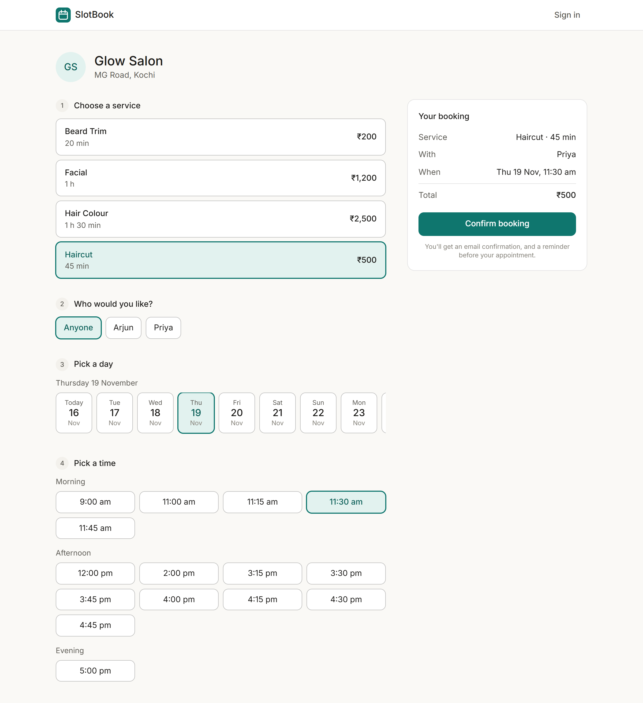
  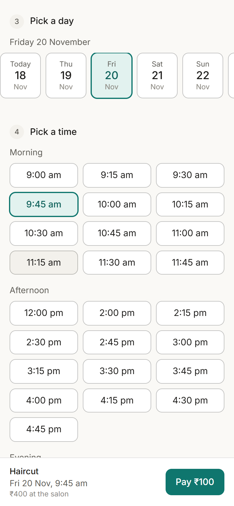
  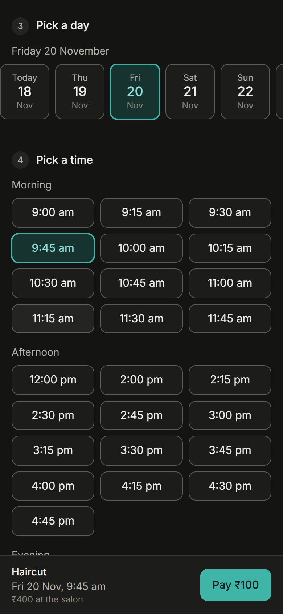
</p>

**Owner setup.** A new owner names the salon and gets a booking address suggested from the name (addresses the app needs for itself, like `dashboard`, are refused, and a taken one says so beside the field). Until the salon can take a booking, a checklist says what's missing and links straight to it.

<p align="center">
  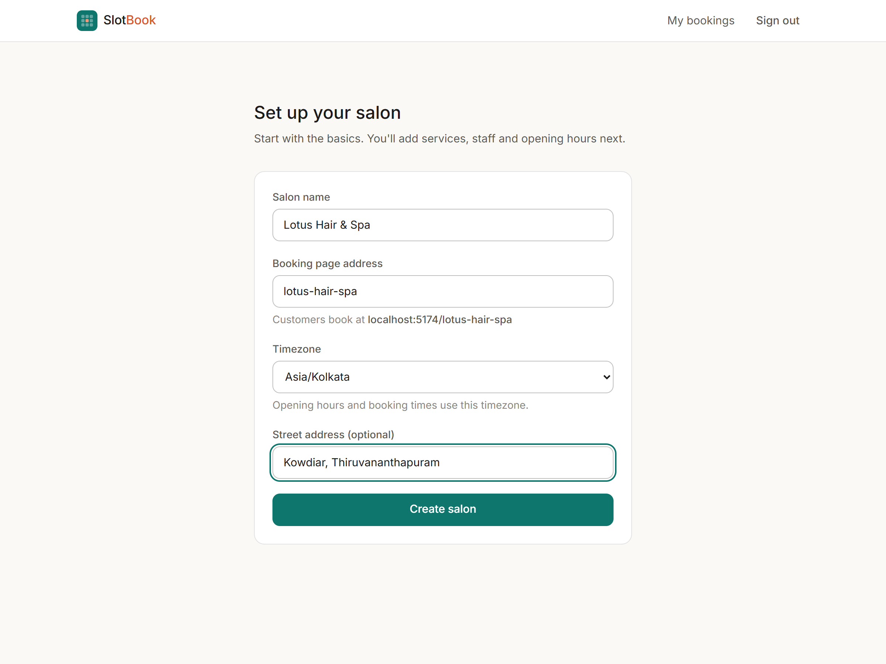
  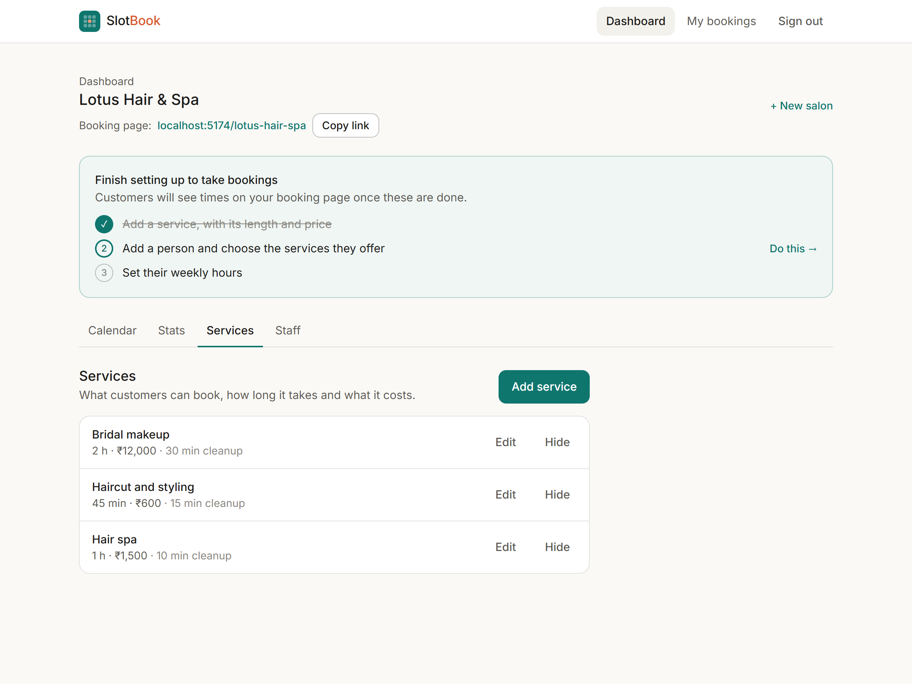
</p>

**Staff, hours and time off.** Each person has the services they offer, a weekly schedule with breaks (several blocks a day, "copy Monday to Tue–Fri"), and time off entered on the salon's own clock.

<p align="center">
  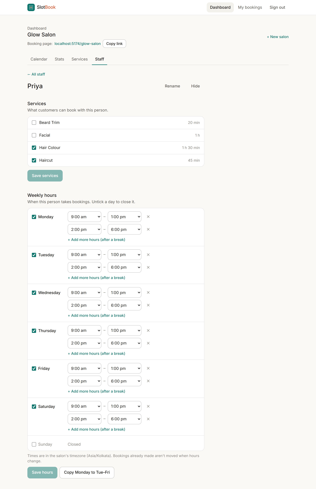
</p>

**Owner weekly calendar.** One colour per staff member, simultaneous bookings side by side, a line for the current time, and filters. Completed bookings carry a check mark. On a phone it becomes a day-by-day list.

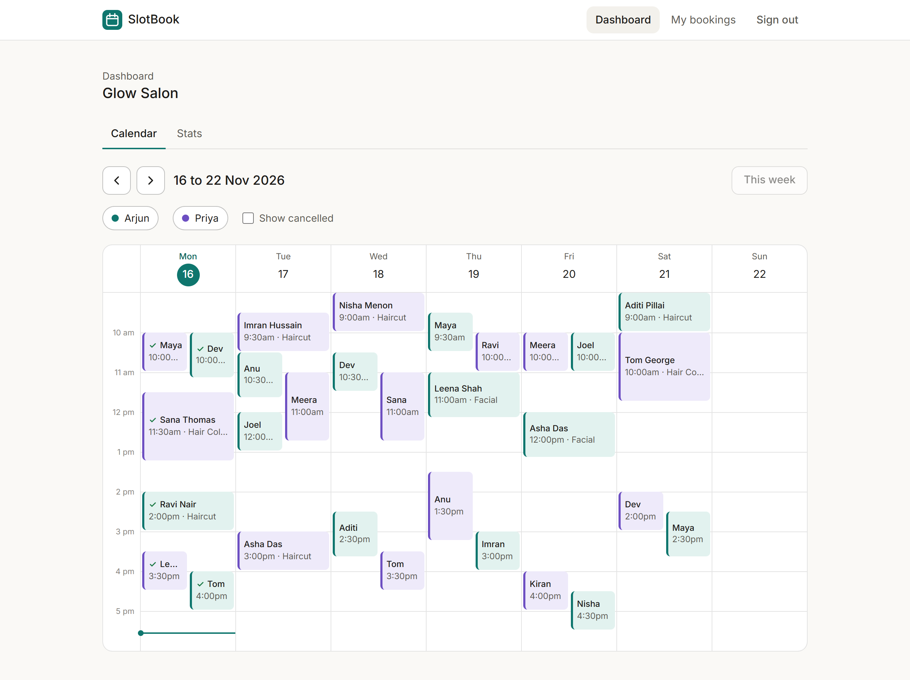

**Owner stats.** Bookings, completed, no-show rate and revenue for a period of your choice, a bar chart per day, how bookings ended, and the top services.

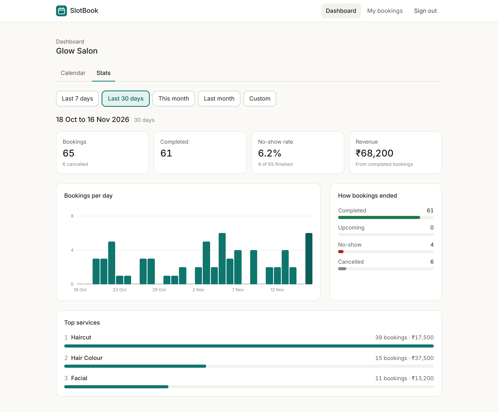

**Owner payments.** The salon sets its deposit and free-cancellation window (with a worked example from one of its own services), sees what SlotBook owes it, and every money movement behind that number: deposits, refunds, SlotBook's 10% commission on kept deposits, and payouts.

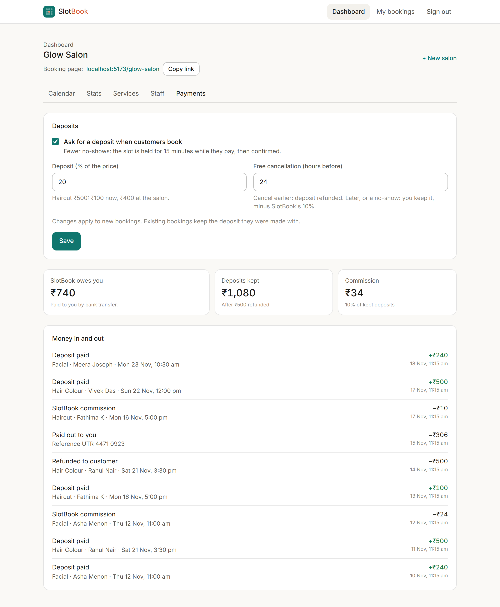

**My bookings with deposits.** A paid booking shows its deposit; a held one shows when the hold ends and a button to pay; a booking cancelled in time shows the refund.

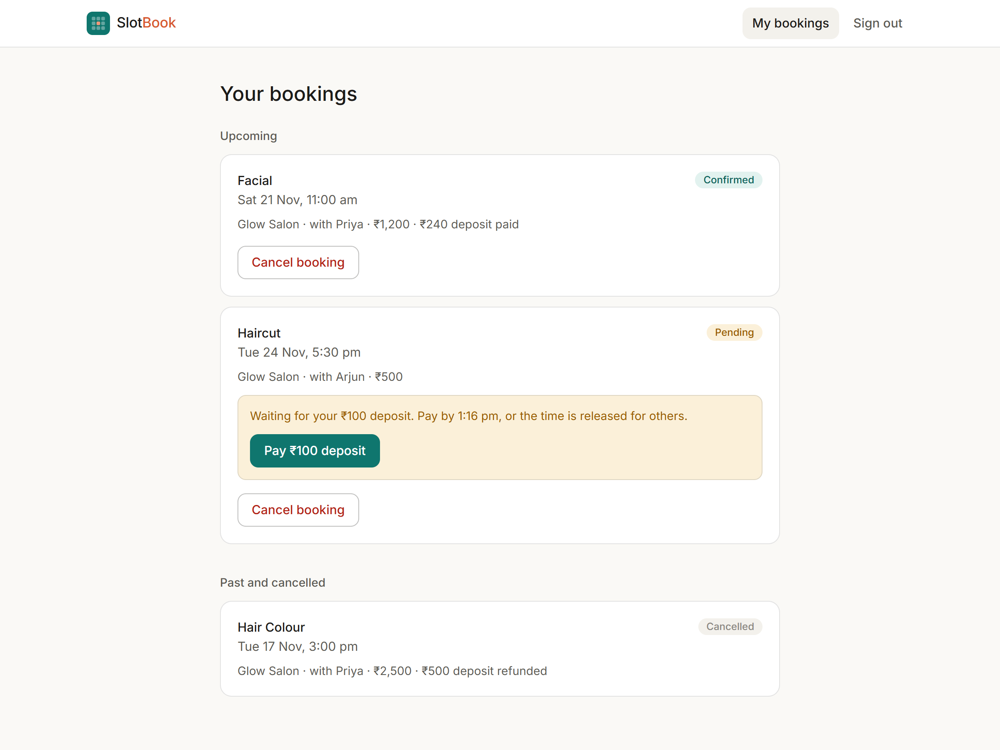

<details>
<summary>Dark mode</summary>

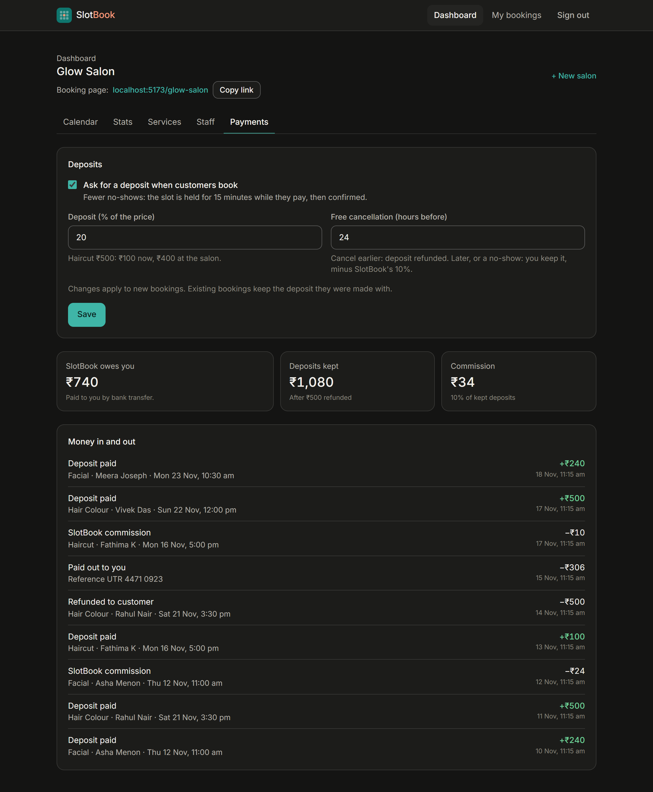

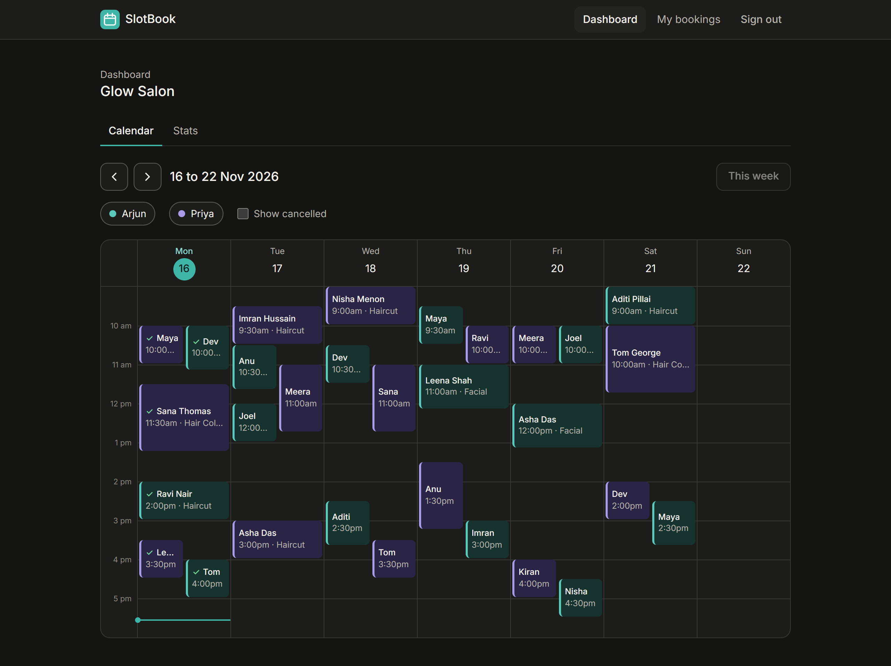

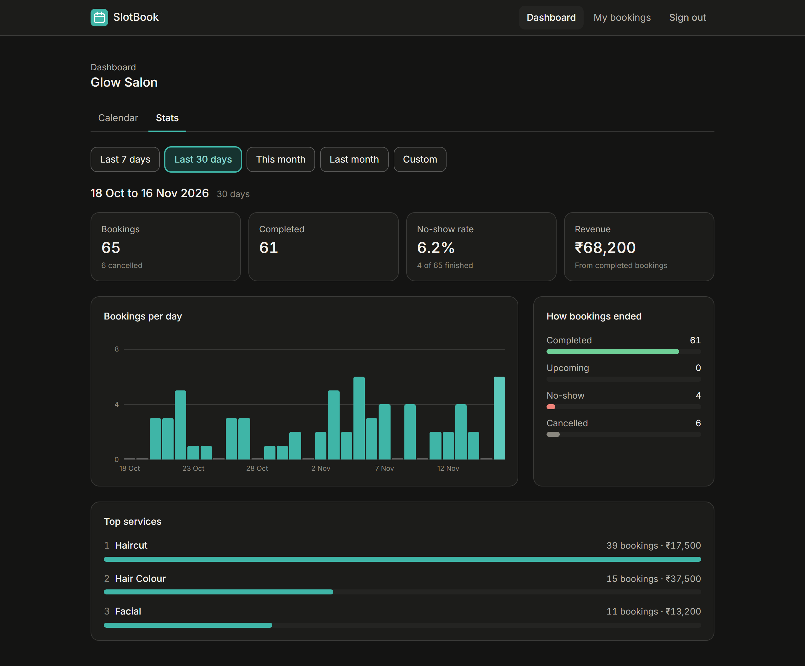

</details>

## Architecture

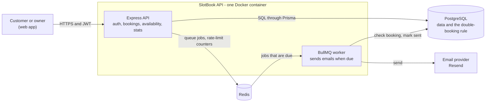

### What happens when a customer books a slot

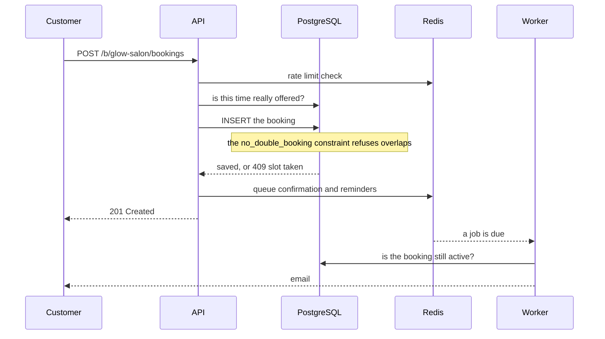

## The interesting problems, and where they are solved

| Problem | How it is handled | Where |
|---|---|---|
| Two customers book the same slot at the same instant | A Postgres exclusion constraint, not an app-level check. A test fires 10 simultaneous requests and exactly 1 succeeds | `prisma/migrations/*_booking_rules`, `tests/bookings.test.ts` |
| Those simultaneous inserts deadlocking on each other | Found by reading `pg_stat_activity` while a flaky test hung: some customers got a 500, and sometimes the requests stuck. Writers for the same staff member now take turns on an advisory lock; a deadlock that still happens is retried, then answered "slot taken" | `writeUnlessTaken()` in `modules/bookings/bookings.service.ts` |
| Which start times are open on a given day? | A pure function: working hours minus time off minus bookings, in the salon's timezone | `modules/availability/availability.ts` |
| Daylight-saving days and timezones | Moments are stored in UTC. Working hours are local clock times, turned into real moments only for a given date | `toRange()` in `availability.ts` |
| Stolen login tokens | Short-lived access token plus a rotating refresh token in an httpOnly cookie. A reused refresh token signs out every session | `modules/auth/auth.service.ts` |
| One owner touching another owner's data | Every owner action starts by loading the business through its owner; strangers get a 404, not a 403 | `getOwnedBusiness()` in `modules/businesses/` |
| Reminder emails for bookings that were cancelled or moved | Jobs sit in a Redis queue, but the database is the source of truth: the worker re-checks before sending | `modules/notifications/` |
| Changing a price would rewrite last month's revenue | Each booking keeps a copy of the price it was made at. The migration that added it filled in existing bookings before making the column required | `migrations/*_booking_price`, `tests/booking-price.test.ts` |
| A search for "%" matched every salon | Prisma's `contains` becomes SQL `LIKE` without escaping, so `%` and `_` acted as wildcards. They are escaped and treated as plain characters | `listPublicBusinesses()` in `modules/businesses/` |
| Two new owners claim the same booking address at once | The unique index decides, not an "is it free?" lookup; the loser gets `SLUG_TAKEN`. Addresses the web app uses itself (`dashboard`, `assets`) are refused | `modules/businesses/`, `tests/businesses.test.ts` |
| A salon whose booking page shows no times, and nobody knows why | The dashboard checks the three things that must line up (a service, someone who offers it, their hours) and shows the next missing step | `apps/web/src/dashboard/setup.ts` |
| A customer claiming "I paid" without paying | The browser's word is never trusted: Razorpay signs `order|payment` with our secret (HMAC-SHA256, compared in constant time), and the amount comes from our own order | `lib/razorpay.ts`, `confirmDeposit()` in `modules/payments/` |
| Paying, then closing the tab before the page reports back | Razorpay's webhook confirms the booking anyway. Its signature is checked against the raw body, before JSON parsing | `modules/payments/payments.webhook.ts` |
| The browser and the webhook arriving together, or twice | One `recordPayment()` for both, with a guarded update: only the first writes anything. A test fires both at once and gets one ledger row | `payments.service.ts`, `tests/payments-webhook.test.ts` |
| An unpaid hold blocking a slot forever | Released on time by a queue job, and also inside the next booking's locked transaction, so it works even with Redis down | `releaseExpiredHolds()` |
| Refunding twice, or recording a refund that never happened | Decide in one transaction (paid → refunded, ledger row), then send to Razorpay from the queue with retries. Each retry first asks Razorpay whether a refund carrying our id already exists | `modules/payments/payments.refunds.ts` |
| Money counted twice | The ledger is append-only (a trigger refuses updates and deletes), signs are checked, and a unique key allows one deposit, commission and refund row per payment | `migrations/*_payments`, `*_ledger_once_per_payment` |
| Two payouts at once overdrawing a salon | A per-salon advisory lock: the second payout waits, then sees the lower balance | `recordPayout()` in `modules/admin/` |
| Abuse and brute-forcing | A Redis fixed-window rate limiter with stricter limits on login and sign-up | `middleware/rateLimit.ts` |
| Debugging production | One structured JSON log line per request with a request id; secrets are never logged | `lib/logger.ts`, `app.ts` |

## Stack

| Layer | Tech |
|---|---|
| API | Node.js 24, Express 5, TypeScript |
| Database | PostgreSQL 17, Prisma 6 |
| Queue and rate limiting | Redis 7, BullMQ |
| Email | Resend (printed to the console when no key is set) |
| Payments | Razorpay Orders, Checkout, refunds and webhooks, called with `fetch` (no SDK) |
| Validation, dates | Zod 4, Luxon |
| Logging | pino |
| Web app | React 19, Vite, Tailwind 4, TanStack Query |
| Tests | Vitest, Supertest (273 API tests against real Postgres and Redis, plus 84 web tests) |
| Packaging and CI | Docker, GitHub Actions |

## Getting started

You need Node 22 or newer and Docker Desktop.

```bash
docker compose up -d                 # PostgreSQL and Redis
cd apps/api
cp .env.example .env                 # then set JWT_ACCESS_SECRET (see the comment in the file)
npm install
npm run db:migrate                   # creates the tables and the double-booking constraint
npm run db:seed                      # demo salon: owner@slotbook.test / password123
npm run dev                          # http://localhost:4000/b/glow-salon
```

Run the tests (they use their own `slotbook_test` database and Redis database 15, so your data is safe):

```bash
npm test                             # from apps/api, with Docker running
```

Run the whole thing from the Dockerfile, exactly as a host would:

```bash
JWT_ACCESS_SECRET=<a long random string> docker compose --profile full up --build
```

Deploying it: see [docs/DEPLOY.md](docs/DEPLOY.md).

## Web app

`apps/web` is a React, Vite and Tailwind app that talks to the API. It has:

- the **home page** (`/`): every salon that's ready to take bookings, with a search box that
  matches a salon's name, its area or a service it offers;
- the customer **booking page** (`/glow-salon`: pick a service, person, day and time, then confirm)
  and **My bookings** (`/me`, with cancel);
- the owner **weekly calendar** (`/dashboard`): a week grid with one colour per staff member,
  simultaneous bookings side by side, a "now" line, filters, and a details dialog to cancel an
  upcoming booking or mark a past one completed or a no-show. On a phone it becomes a day-by-day list.

- the owner **stats dashboard** (`/dashboard/<id>/stats`): bookings, completed, no-show rate and
  revenue for a period you choose (last 7 or 30 days, this or last month, or your own dates, up to
  92 days), a bar chart of bookings per day, how bookings ended, and the top services. The chart is
  plain elements with no chart library, and is readable by screen readers through a hidden table.
- owner **setup** (`/dashboard/new`): create a salon, then the **Services** tab (add, edit, hide;
  prices typed in rupees and stored as whole paise) and the **Staff** tab (who offers what, weekly
  hours with breaks, time off). A checklist shows what's still missing before the salon can take a
  booking, and the booking link sits under the salon's name with a Copy button.

To try the owner side locally, sign in as `owner@slotbook.test` (created by `npm run db:seed`).

```bash
npm run dev -w @slotbook/web         # http://localhost:5173 (the API must be running on port 4000)
```

- **Look and feel** lives in one place: the colour, corner and font tokens at the top of
  `apps/web/src/index.css`. Change them there and the whole app follows, including dark mode.
- **Phone first:** the booking page is designed for a small screen, with a confirm bar that stays
  in reach, and widens into two columns on a desktop.
- **Sign-in** keeps the short-lived access token only in memory and the refresh token in an
  httpOnly cookie, so a page script can never read either one long-term.
- To point it at a deployed API, set `VITE_API_URL` (see `apps/web/.env.example`).

## API

Customers and owners sign in with `POST /auth/login` and send `Authorization: Bearer <accessToken>`.

| Who | Method and path | What it does |
|---|---|---|
| Anyone | `GET /b?q=` | Salons ready to take bookings, optionally searched by name, area or service |
| Anyone | `GET /b/:slug` | The salon's public page: services and staff |
| Anyone | `GET /b/:slug/availability?serviceId=&date=&staffId=` | Open start times for a day |
| Customer | `POST /b/:slug/bookings` | Book a slot |
| Customer | `GET /me/bookings` | My bookings |
| Customer | `POST /me/bookings/:id/cancel` | Cancel |
| Customer | `POST /me/bookings/:id/reschedule` | Move to another time |
| Anyone | `POST /auth/register`, `/auth/login`, `/auth/refresh`, `/auth/logout` | Accounts and sessions |
| Anyone | `GET /auth/me` | The signed-in user |
| Anyone signed in | `PATCH /auth/me` | Edit your name and phone (not email) |
| Anyone signed in | `POST /auth/password` | Change password (current one required); signs out other devices |
| Anyone signed in | `POST /auth/sessions/revoke-others` | Sign out everywhere except this browser |
| Owner | `POST /businesses`, `GET /businesses/mine`, `PATCH /businesses/:id` | Manage salons |
| Owner | `/businesses/:id/services` | Create, list, update, hide and show again |
| Owner | `/businesses/:id/staff`, `.../staff/:staffId`, `.../staff/:staffId/services` | Add, rename, hide staff, and what each one offers |
| Owner | `.../staff/:staffId/working-hours` | Weekly schedule, split shifts allowed |
| Owner | `.../staff/:staffId/time-off` | Leave and holidays |
| Owner | `GET /businesses/:id/bookings` | Bookings in a date range |
| Owner | `PATCH /businesses/:id/bookings/:bookingId/status` | Mark completed, no-show or cancelled |
| Owner | `GET /businesses/:id/calendar` | Bookings grouped by day |
| Owner | `GET /businesses/:id/stats` | Counts, no-show rate, revenue, per-day totals, top services |
| Owner | `GET /businesses/:id/payments` | Deposit settings, what SlotBook owes the salon, and its ledger rows |
| Customer | `GET /me/bookings/:id/payment` | Reopen the deposit payment for a held booking |
| Customer | `POST /me/bookings/:id/pay` | Confirm a deposit with Razorpay's signed result |
| Razorpay | `POST /webhooks/razorpay` | Payment and refund events, checked by signature |
| Admin | `GET /admin/balances`, `/admin/refunds`, `/admin/audit` | Balances per salon, refunds needing attention, the audit log |
| Admin | `POST /admin/businesses/:id/payouts`, `/admin/refunds/:id/retry` | Record a payout, retry a refund |

With deposits on, `POST /b/:slug/bookings` answers with a `pending` booking held for 15 minutes
and a `payment` object (order id, amount, public key id) for Razorpay Checkout. Admins are made
from the command line only: `npm run admin:grant -- someone@example.com`.

Errors always look like `{ "error": { "code": "...", "message": "..." } }`. Every response carries an `X-Request-Id` header.

## Project structure

```
apps/api/
  prisma/
    schema.prisma                 all tables
    migrations/                   SQL history, including the double-booking rule
    seed.ts                       demo data
  src/
    app.ts, server.ts
    lib/                          env, db, redis, logger, mailer, errors
    middleware/                   auth, validate, rateLimit, errorHandler
    modules/                      one folder per feature: schema, service, routes
      auth/  businesses/  services/  staff/  working-hours/  time-off/
      availability/  bookings/  notifications/  stats/
      payments/  admin/           deposits, refunds, webhooks, the ledger; SlotBook's admin
  tests/                          API tests and shared helpers
Dockerfile                        production image
docker-compose.yml                dev services, plus the full stack with --profile full
.github/workflows/ci.yml          type check, tests and an image build on every push
apps/web/                         the React web app (booking page, My bookings, owner dashboard)
docs/DEPLOY.md                    putting it online
docs/brand/                       the logo, light and dark
```

## Roadmap

- [x] **Week 0:** scaffold, schema, double-booking constraint, auth, businesses module
- [x] **Week 1:** services CRUD
- [x] **Week 2:** auth tests against a test database
- [x] **Week 3:** staff, working hours, time off
- [x] **Week 4:** the availability function and endpoint
- [x] **Week 5:** book, cancel, reschedule, and the 10-way race test
- [x] **Week 6:** reminder emails with Redis and BullMQ
- [x] **Week 7:** owner calendar and stats, rate limiting, structured logging
- [x] **Week 8:** Dockerfile, GitHub Actions CI, deployment guide, architecture diagram
- [x] **Web app:** booking page, "My bookings", owner calendar and stats
- [x] **Live:** deployed on Vercel, Render and Neon
- [x] **Owner setup:** create a salon, services, staff, hours and time off, the setup checklist,
  and bookings that keep the price they were made at
- [x] **Hardening:** the booking deadlock fix, zod 4 for a security advisory, and the database
  moved to Neon before Render's free one expired
- [x] **Discovery:** the home page lists every ready salon, with search
- [x] **Payments:** Razorpay deposits with 15-minute holds, webhooks, refunds by the
  cancellation rule, SlotBook's 10% commission, an append-only ledger, the owner's Payments
  tab and a super admin for payouts

Ideas for later: Google Calendar sync, a waitlist, and a Claude-powered "book by chat" assistant.
