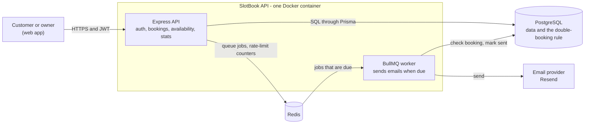
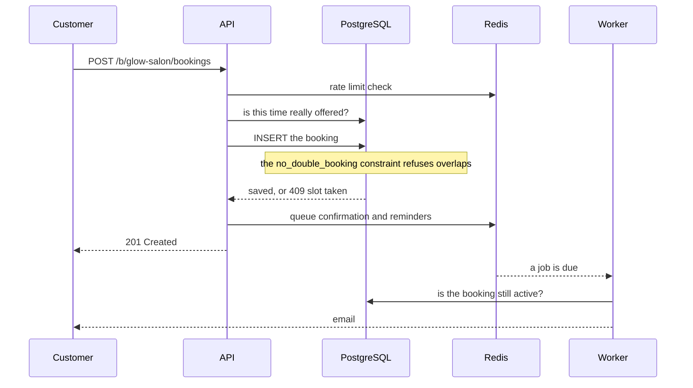

# SlotBook

Appointment booking for salons and clinics. Businesses set up services, staff and working
hours; customers book open slots and get email reminders; owners see a calendar and stats.

A full-stack learning project built around real backend problems: authentication and
authorization, timezones, working out availability, race conditions, background jobs,
and running it all in production.

## Architecture



### What happens when a customer books a slot



## The interesting problems, and where they are solved

| Problem | How it is handled | Where |
|---|---|---|
| Two customers book the same slot at the same instant | A Postgres exclusion constraint, not an app-level check. A test fires 10 simultaneous requests and exactly 1 succeeds | `prisma/migrations/*_booking_rules`, `tests/bookings.test.ts` |
| Which start times are open on a given day? | A pure function: working hours minus time off minus bookings, in the salon's timezone | `modules/availability/availability.ts` |
| Daylight-saving days and timezones | Moments are stored in UTC. Working hours are local clock times, turned into real moments only for a given date | `toRange()` in `availability.ts` |
| Stolen login tokens | Short-lived access token plus a rotating refresh token in an httpOnly cookie. A reused refresh token signs out every session | `modules/auth/auth.service.ts` |
| One owner touching another owner's data | Every owner action starts by loading the business through its owner; strangers get a 404, not a 403 | `getOwnedBusiness()` in `modules/businesses/` |
| Reminder emails for bookings that were cancelled or moved | Jobs sit in a Redis queue, but the database is the source of truth: the worker re-checks before sending | `modules/notifications/` |
| Abuse and brute-forcing | A Redis fixed-window rate limiter with stricter limits on login and sign-up | `middleware/rateLimit.ts` |
| Debugging production | One structured JSON log line per request with a request id; secrets are never logged | `lib/logger.ts`, `app.ts` |

## Stack

| Layer | Tech |
|---|---|
| API | Node.js 24, Express 5, TypeScript |
| Database | PostgreSQL 17, Prisma 6 |
| Queue and rate limiting | Redis 7, BullMQ |
| Email | Resend (printed to the console when no key is set) |
| Validation, dates | Zod, Luxon |
| Logging | pino |
| Tests | Vitest, Supertest (157 tests, against real Postgres and Redis) |
| Packaging and CI | Docker, GitHub Actions |

## Getting started

You need Node 22 or newer and Docker Desktop.

```bash
docker compose up -d                 # PostgreSQL and Redis
cd apps/api
cp .env.example .env                 # then set JWT_ACCESS_SECRET (see the comment in the file)
npm install
npm run db:migrate                   # creates the tables and the double-booking constraint
npm run db:seed                      # demo salon: owner@slotbook.test / password123
npm run dev                          # http://localhost:4000/b/glow-salon
```

Run the tests (they use their own `slotbook_test` database and Redis database 15, so your data is safe):

```bash
npm test                             # from apps/api, with Docker running
```

Run the whole thing from the Dockerfile, exactly as a host would:

```bash
JWT_ACCESS_SECRET=<a long random string> docker compose --profile full up --build
```

Deploying it: see [docs/DEPLOY.md](docs/DEPLOY.md).

## Web app

`apps/web` is a React, Vite and Tailwind app that talks to the API. It has:

- the customer **booking page** (`/glow-salon`: pick a service, person, day and time, then confirm)
  and **My bookings** (`/me`, with cancel);
- the owner **weekly calendar** (`/dashboard`): a week grid with one colour per staff member,
  simultaneous bookings side by side, a "now" line, filters, and a details dialog to cancel an
  upcoming booking or mark a past one completed or a no-show. On a phone it becomes a day-by-day list.

- the owner **stats dashboard** (`/dashboard/<id>/stats`): bookings, completed, no-show rate and
  revenue for a period you choose (last 7 or 30 days, this or last month, or your own dates, up to
  92 days), a bar chart of bookings per day, how bookings ended, and the top services. The chart is
  plain elements with no chart library, and is readable by screen readers through a hidden table.

To try the owner side locally, sign in as `owner@slotbook.test` (created by `npm run db:seed`).

```bash
npm run dev -w @slotbook/web         # http://localhost:5173 (the API must be running on port 4000)
```

- **Look and feel** lives in one place: the colour, corner and font tokens at the top of
  `apps/web/src/index.css`. Change them there and the whole app follows, including dark mode.
- **Phone first:** the booking page is designed for a small screen, with a confirm bar that stays
  in reach, and widens into two columns on a desktop.
- **Sign-in** keeps the short-lived access token only in memory and the refresh token in an
  httpOnly cookie, so a page script can never read either one long-term.
- To point it at a deployed API, set `VITE_API_URL` (see `apps/web/.env.example`).

## API

Customers and owners sign in with `POST /auth/login` and send `Authorization: Bearer <accessToken>`.

| Who | Method and path | What it does |
|---|---|---|
| Anyone | `GET /b/:slug` | The salon's public page: services and staff |
| Anyone | `GET /b/:slug/availability?serviceId=&date=&staffId=` | Open start times for a day |
| Customer | `POST /b/:slug/bookings` | Book a slot |
| Customer | `GET /me/bookings` | My bookings |
| Customer | `POST /me/bookings/:id/cancel` | Cancel |
| Customer | `POST /me/bookings/:id/reschedule` | Move to another time |
| Anyone | `POST /auth/register`, `/auth/login`, `/auth/refresh`, `/auth/logout` | Accounts and sessions |
| Anyone | `GET /auth/me` | The signed-in user |
| Owner | `POST /businesses`, `GET /businesses/mine`, `PATCH /businesses/:id` | Manage salons |
| Owner | `/businesses/:id/services` | Create, list, update, hide services |
| Owner | `/businesses/:id/staff`, `.../staff/:staffId/services` | Staff and what each one offers |
| Owner | `.../staff/:staffId/working-hours` | Weekly schedule, split shifts allowed |
| Owner | `.../staff/:staffId/time-off` | Leave and holidays |
| Owner | `GET /businesses/:id/bookings` | Bookings in a date range |
| Owner | `PATCH /businesses/:id/bookings/:bookingId/status` | Mark completed, no-show or cancelled |
| Owner | `GET /businesses/:id/calendar` | Bookings grouped by day |
| Owner | `GET /businesses/:id/stats` | Counts, no-show rate, revenue, per-day totals, top services |

Errors always look like `{ "error": { "code": "...", "message": "..." } }`. Every response carries an `X-Request-Id` header.

## Project structure

```
apps/api/
  prisma/
    schema.prisma                 all tables
    migrations/                   SQL history, including the double-booking rule
    seed.ts                       demo data
  src/
    app.ts, server.ts
    lib/                          env, db, redis, logger, mailer, errors
    middleware/                   auth, validate, rateLimit, errorHandler
    modules/                      one folder per feature: schema, service, routes
      auth/  businesses/  services/  staff/  working-hours/  time-off/
      availability/  bookings/  notifications/  stats/
  tests/                          API tests and shared helpers
Dockerfile                        production image
docker-compose.yml                dev services, plus the full stack with --profile full
.github/workflows/ci.yml          type check, tests and an image build on every push
docs/DEPLOY.md                    putting it online
```

## Roadmap

- [x] **Week 0:** scaffold, schema, double-booking constraint, auth, businesses module
- [x] **Week 1:** services CRUD
- [x] **Week 2:** auth tests against a test database
- [x] **Week 3:** staff, working hours, time off
- [x] **Week 4:** the availability function and endpoint
- [x] **Week 5:** book, cancel, reschedule, and the 10-way race test
- [x] **Week 6:** reminder emails with Redis and BullMQ
- [x] **Week 7:** owner calendar and stats, rate limiting, structured logging
- [x] **Week 8:** Dockerfile, GitHub Actions CI, deployment guide, architecture diagram

Frontend: the customer booking page, "My bookings", the owner calendar and the stats dashboard are built.

Ideas for later: Google Calendar sync, Stripe deposits to reduce no-shows,
a waitlist, and a Claude-powered "book by chat" assistant.
